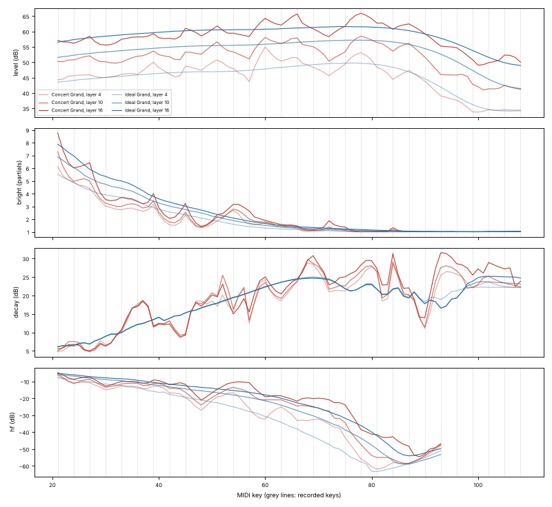

# FM Piano

An acoustic piano emulated with **FM (phase-modulation) synthesis** in Rust,
compiled to WebAssembly. It has two engines:

* **Idealised piano**: every key follows the same smooth physical laws
  (stiff strings, hammer, soundboard, strike point, two-stage decay),
  calibrated on recordings of a real grand, with the laws' parameters exposed
  as voicing controls.
* **Fitted**: every recorded key's parameters fitted to those recordings,
  as close to that particular instrument as FM gets.

**Play it:** https://madadog.github.io/synthprotos/ (on-screen keys, computer
keyboard, or a MIDI keyboard; includes an A/B comparison against the
recordings).

The synthesiser contains no samples. Every sound comes from sine operators
modulating each other. The free
[Salamander Grand Piano V3](https://archive.org/details/SalamanderGrandPianoV3)
recordings (Yamaha C5, 30 keys × 16 velocity layers, CC-BY 3.0) were used
only as the target. Tools here measure them, fit the FM model to them, and
score the Rust engine's output against them with the same analysis code.

## The model

Both engines share the voice: FM stacks on the inharmonic partials, unison
strings, hammer noise, dampers. They differ in where each note's stack
parameters come from (fitted per recorded key, or computed from smooth laws;
see [The idealised piano](#the-idealised-piano)).

| piano physics | FM implementation |
|---|---|
| Stiff strings: partials are sharp, `f_n = n·f0·√(1+B·n²)`; *B* goes from ~7·10⁻⁵ (tenor) to ~2·10⁻² (top C) | *B* and the stretched tuning were measured on all 30 recorded keys. Every carrier sits on a stretched partial. |
| Dense spectra (80+ partials in the bass) | 14–24 two-operator **stacks** per note. A stack's carrier sits on partial *c*. Its modulator runs at the *local* partial spacing, so the sidebands `f_c ± j·f_m` land on the neighbouring inharmonic partials. The stack on partial 1 uses the classic 1:1 ratio. |
| Sidebands must stay in tune | Fitted engine: stacks sit on partials 1, 2, 3, 4, 6, 9, 13, 18, 25, 35, 50, 70 (up to the last audible partial); the idealised engine uses a denser set (below). More are added wherever no stack's sideband reaches a partial in tune. Each stack's modulation index is capped so that sidebands beating against the true partial by more than min(⅕ ERB, 12 Hz) stay ~20 dB down. In the top octaves (very stiff strings) this turns the stacks into near-pure carriers. |
| Upper partials decay faster | Each modulation index decays from *I₀* to *I∞*, so FM brightness falls over time. |
| Two-stage decay and unison beating ("prompt sound" and "aftersound"); 1, 2 or 3 strings per note | Each stack's envelope is a fast plus a slow exponential. On partials 1–4 they are rendered as the modes of the note's unison strings: one carrier for single strings, prompt and aftersound carriers for string pairs, and a prompt plus two aftersound carriers for triples. The carriers are spread by the unison detuning measured on the recordings and start in phase, like strings struck by one hammer. Their drift gives the beating. |
| Harder strikes are brighter | Fitted engine: index and amplitude envelopes fitted separately for every velocity layer. Idealised engine: a shorter hammer contact (a wider low-pass) for faster strikes. |
| Hammer knock and action thump | Two noisy feedback-FM pairs: a short broadband click, plus a low thump with a slow tail that dominates the attack of the top octaves. They were tuned on the bands below the fundamental. |
| Dampers, pedal, room | Damper release, with no dampers above F#6. Sustain pedal, an 8-line FDN reverb, and key panning. |

### Fitting (fitted engine)

FM spectra are Bessel functions, so the power a stack puts on each partial at
time *t* is known in closed form:

```
a(t) = A1·e^(−t/τ1) + A2·e^(−t/τ2)        I(t) = I∞ + (I0 − I∞)·e^(−t/τI)
P_n(t) = Σ_k ā_k(t)² · J_{n−c_k}(I_k(t))²       (1:1 stack: J_{n−1} + (−1)ⁿ J_{n+1})
```

`tools/fit/fmfit.py` fits these seven parameters per stack by least squares
with an analytic Jacobian. The target is each recording's partial envelopes,
summed into ERB bands (roughly how the ear groups unresolved partials) and
weighted by level. It also models what an STFT frame measures (the envelope
averaged over the analysis window), so energy can't hide inside the attack.
The loudest layer of each key is fitted from scratch with restarts. Softer
layers (9 of the 16) are fitted by continuation, which keeps the parameters
smooth in velocity; the remaining layers are interpolated. `export_tables.py` turns the results into
`crates/fmpiano/src/tables.rs`, and the engine interpolates between keys and
layers.

### The idealised piano

The recordings were made every third key, so the fitted engine changes
voicing from one recorded key to the next, and the keys in between are
blends of two recorded neighbours. That is how a sampled instrument sounds,
not how a piano is built. The idealised engine (`crates/fmpiano/src/ideal.rs`)
describes every key with the same laws instead:

```
f_n = n·f0·√(1 + B·n²)                                       stiff string, smooth B(key) and tuning
A_n = G(key, v) · H(f_n) · R(f_n) · S(n) · n^−γ(key)          initial partial amplitudes
  H = (1 + (f·T)²)^(−q/2),  T = T(key, v)                    hammer contact low-pass (shorter = brighter)
  R = x/(1 + x)/√(1 + (f/f_hi)²),  x = (f/f_lo)^(2k)         soundboard radiation, one curve for all keys
  S = √((sin²(π n β) + ε²)/(½ + ε²))                         strike point β = 1/8.5, notch depth ε(key)
a_n(t) = A_n ((1 − w) e^(−r σ_n t) + w e^(−σ_n t))           prompt sound and aftersound
  σ_n = b1(key) + b3(key)·f_n²                               string losses (Bank & Välimäki)
```

Every key dependence is a polynomial of degree ≤ 3 over the keyboard. The 38
coefficients come from one joint least-squares fit to the partial envelopes
of all 30 recorded keys at five dynamics (`tools/ideal/calibrate.py`). It uses
the same objective as the per-key fit (ERB bands, analysis windows, the room's
noise floor) and is then shifted so the laws carry the recordings' energy. A
fit in dB alone lands about 2.4 dB low, on the geometric mean of the peaky
band levels. The data shaped the laws: a steep soundboard high-pass (the
recordings' A0 fundamental is about 35 dB below its strongest partial),
strike notches deep in the bass that fill in by the middle of the keyboard,
nearly frequency-independent decay below the top two octaves, and a level
that grows faster than linearly in dB with velocity at the loud end.

At note-on the laws become FM stacks (no fitting at run time):

1. stacks on partials 1–7, then about 1.22× apart (9, 11, 14, 16, 20, 25, …),
   plus extra stacks wherever no sideband reaches a partial in tune;
2. each partial goes to its nearest stack; the stack gets that power, and an
   index from its spread (an FM spectrum's variance in partials is *I*²/2);
3. multiplicative updates correct for the power neighbouring stacks put in
   each other's territory;
4. the prompt and aftersound times come from the stack's centre partial, and
   the index decays so the spread follows the faster decay of outer partials;
5. stacks start at golden-angle phases. Neighbouring stacks put sidebands on
   the same partials, and with equal phases a lower sideband (J₋₁ = −J₁)
   cancels the upper sideband of the stack below at the attack.

Rendered with the hammer noise and unison strings switched off, the FM notes
match additive renders of the laws within 2.1 / 1.6 / 1.0 dB (ERB bands;
bass / tenor / middle) and 0.5–1.0 dB on partials 1–8. The top octaves are
pure carriers and match exactly.

**Voicing controls** (web page and `fmpiano::param`): strike point, strike
notch depth, soundboard low corner (bass fundamentals), high-partial damping,
aftersound and dynamic range, on top of the controls both engines share.

**Smoothness.** `tools/ideal/smoothness.py` renders all 88 keys at p, mf and
ff and measures loudness, brightness, decay and high-frequency content. The
roughness below is the RMS of the second difference along the keyboard ÷ √6:
0 for any straight line, and the ripple amplitude for key-to-key alternation.

| mf (layer 10) | level | brightness (partials) | decay 0.3–2 s | share above partial 6.5 |
|---|---|---|---|---|
| Fitted *Concert Grand* | 0.48 dB | 0.11 | 1.55 dB | 0.55 dB |
| *Ideal Grand* | 0.02 dB | 0.02 | 0.35 dB | 0.13 dB |



What remains in the ideal engine's decay ripple comes from the unison beating,
which both engines share.

### Unison strings

`tools/analysis/unison.py` splits every partial of the recordings into its
components with ESPRIT, a high-resolution subspace method. A0, C1 and D#1
have a single component per partial (any second one sits around −40 dB):
these are single strings. From F#1 up, partials show several strong
components within about a cent of each other. Their spread is about 1 cent up
to C5 and about 2.4 cents in the top octaves, and the engine uses this as the
unison detuning. Pairs and triples cannot be told apart in the recordings
(two strings with two polarisations also give 3–4 components). So the usual
layout of a grand this size is used: single strings A0–E1, pairs F1–E2,
triples from F2.

Three tone controls (also on the web page) adjust this:

* **Unison detune**: a multiplier on the measured spread, i.e. beating speed
  (0 = perfectly tuned unisons).
* **Unison balance**: 0 keeps the prompt sound on one string and the aftersound
  on the other(s), which is closest to the recordings in the comparison; 1
  shares both equally between the strings, giving deep beating throughout.
* **Strings per note**: as on the recorded grand, or 1, 2 or 3 everywhere.

### Accuracy

Engine renders (dry, mono) compared with the recordings by
`tools/analysis/compare.py`, for all 30 recorded keys at p/mf/ff. Fitted
engine (*Concert Grand*): *Band*
is the RMS difference of time-smoothed ERB-band spectrograms from 10 ms to
8 s, weighted by A-weighted level and ignoring anything 70 dB below the peak.
*Partials* is the RMS level error of partials 1–8 at 0.1, 0.5 and 2 s.

| keys | band, p | band, mf | band, ff | partials 1–8 | pitch error (median) | early decay, FM / recording |
|---|---|---|---|---|---|---|
| A0–A1 (bass) | 3.9 dB | 3.8 dB | 4.6 dB | 6.1 dB | 2.4 ¢ | −5 / −5 dB/s |
| C2–A3 (tenor) | 4.7 dB | 4.6 dB | 4.6 dB | 4.9 dB | 2.0 ¢ | −11 / −12 dB/s |
| C4–A5 (middle) | 4.5 dB | 4.6 dB | 5.0 dB | 4.2 dB | 1.3 ¢ | −26 / −27 dB/s |
| C6–C8 (treble) | 8.9 dB | 8.5 dB | 8.8 dB | 5.2 dB | 2.7 ¢ | −24 / −23 dB/s |

Over all 90: band error 5.8 dB (median 5.0), partials 5.0 dB, median peak-level
difference 1.3 dB. For scale, per-partial double-exponential envelopes (an
additive model with a free envelope for every partial) reach about 1.3–2.4 dB
on the same data. The remaining treble error is mostly the noisy
soundboard/sympathetic "halo" around each fundamental, which the FM noise
generators approximate only roughly.

The [accuracy report](https://madadog.github.io/synthprotos/img/) has
per-note plots (recording solid, FM dashed) and all metrics.

Idealised engine (*Ideal Grand*), same measure:

| keys | band, p | band, mf | band, ff | partials 1–8 | pitch error (median) | early decay, FM / recording |
|---|---|---|---|---|---|---|
| A0–A1 (bass) | 6.1 dB | 5.5 dB | 5.8 dB | 9.0 dB | 1.9 ¢ | −5 / −5 dB/s |
| C2–A3 (tenor) | 6.8 dB | 6.3 dB | 6.1 dB | 7.2 dB | 1.7 ¢ | −10 / −12 dB/s |
| C4–A5 (middle) | 6.6 dB | 6.3 dB | 6.8 dB | 6.6 dB | 0.8 ¢ | −23 / −27 dB/s |
| C6–C8 (treble) | 9.1 dB | 8.9 dB | 9.4 dB | 7.4 dB | 4.1 ¢ | −23 / −23 dB/s |

Over all 90: band error 7.2 dB (median 6.9), partials 7.4 dB. The laws
themselves are 7.3 dB from the recordings on the calibration objective, so
almost all of the extra 1.4 dB over the fitted engine is the individuality of
each recorded key (its own voicing, tuning and microphone colour), which the
idealised engine leaves out on purpose. The FM mapping adds little.

## Layout

```
crates/fmpiano/        the synthesiser (pure Rust, no dependencies)
  src/model.rs         key/velocity -> FM voice parameters (fitted engine), presets, hammer model
  src/ideal.rs         the idealised piano: smooth laws -> FM stacks
  src/voice.rs         one note: FM stacks, knock, attack/damper envelopes
  src/synth.rs         polyphony, sustain pedal, mixing, reverb
  src/tables.rs        GENERATED fitted parameters (30 keys x 16 layers)
crates/fmpiano-wasm/   C-ABI exports for the browser (no wasm-bindgen)
crates/fmpiano-cli/    offline renderer (WAV) used for the comparisons
docs/                  the GitHub Pages site (AudioWorklet + UI)
tools/analysis/        pitch/inharmonicity/partial-envelope analysis, unison-string (ESPRIT)
                       analysis, comparison report
tools/fit/             model fitting, knock tuning, table export; results/ holds the fit
tools/ideal/           calibration of the idealised laws (calibration.json), Python
                       prototype of the law -> stacks mapping, smoothness measurement
```

## Building

```sh
cargo test --release -p fmpiano
cargo build --release -p fmpiano-wasm --target wasm32-unknown-unknown
cp target/wasm32-unknown-unknown/release/fmpiano_wasm.wasm docs/fmpiano.wasm
python3 -m http.server -d docs 8000      # then open http://localhost:8000
```

Render notes offline:

```sh
cargo run --release -p fmpiano-cli -- note --key 60 --vel 90 --dur 6 -o c4.wav
cargo run --release -p fmpiano-cli -- demo -o demo.wav --preset 6     # 6 = Ideal Grand
cargo run --release -p fmpiano-cli -- presets                         # list the presets
```

## Reproducing the fit and the comparison

```sh
pip install numpy scipy soundfile matplotlib
tools/fetch_samples.sh                         # Salamander OGGs from the npm registry -> ./samples
python3 tools/fit/batch_fit.py out/fit A0 C1 D#1 F#1 A1 C2 ...   # all 30 recorded keys
python3 tools/fit/export_tables.py out/fit     # -> crates/fmpiano/src/tables.rs
cargo run --release -p fmpiano-cli -- refset --outdir out/refset --layers 4,10,16
python3 tools/analysis/compare.py out/refset --layers 4,10,16 --plots docs/img --json out/report.json
```

`tools/fit/results/` contains the fit used for the current tables, so
`export_tables.py tools/fit/results` regenerates them without refitting.

The idealised engine:

```sh
python3 tools/ideal/calibrate.py --init tools/ideal/calibration.json --json out/calibration.json --plots out/
cp out/calibration.json tools/ideal/ && python3 tools/ideal/port_laws.py   # -> ideal.rs
python3 tools/ideal/smoothness.py --presets 0,6 --plots out/
cargo run --release -p fmpiano-cli -- refset --outdir out/ideal --layers 4,10,16 --preset 6
python3 tools/analysis/compare.py out/ideal --layers 4,10,16
```

## MIDI

The MIDI panel (a sidebar on wide screens, at the bottom on narrow ones) asks
for access only when you press **Connect**. Doing it from a click lets the
browser show its prompt. The panel
shows whether Web MIDI exists, whether the page is a secure context, the
permission state, every port the browser reports, and a decoded log of
incoming messages, with explanations when a request is refused.

* **Firefox** (108+) grants MIDI per site with an automatically generated
  "site permission add-on": accept the prompt next to the address bar. If it
  was dismissed before, the request fails at once with `SecurityError`.
  Remove the old decision in `about:addons` → *Site Permissions*, or in the
  site information panel, and connect again. Private windows cannot install
  the add-on.
* **Chrome / Edge**: allow "Use your MIDI devices"; re-enable it under Site
  settings → MIDI devices if it was blocked.
* **Safari** has no Web MIDI.

## GitHub Pages

`.github/workflows/pages.yml` tests the synth, builds the wasm and deploys
`docs/` with GitHub Actions. To publish, set **Settings → Pages → Build and
deployment → Source** to **GitHub Actions**. Alternatively, choose *Deploy
from a branch* with the `/docs` folder; a prebuilt `docs/fmpiano.wasm` is
committed for that case.

## License and credits

Code: MIT (see `LICENSE`).
Reference recordings: Salamander Grand Piano V3 by Alexander Holm,
[CC BY 3.0](https://creativecommons.org/licenses/by/3.0/). The 6-second
excerpts in `docs/samples/` are re-encoded from those recordings and stay
under that license.
